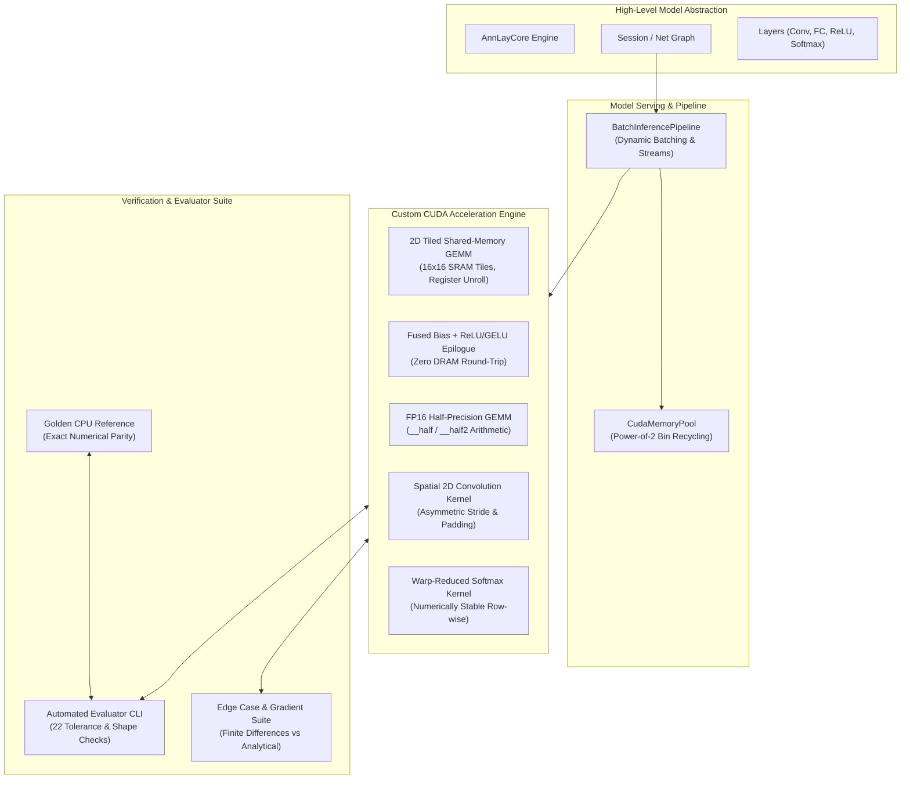

# ConvNetCpp: High-Performance C++ & CUDA Neural Acceleration Engine

[](https://github.com/username/ConvNetCpp/actions)
[](https://developer.nvidia.com/cuda-zone)
[](LICENSE)

`ConvNetCpp` is a high-performance scientific machine learning engine written in modern C++17 and custom CUDA. Designed for high-throughput model inference, computer vision pipelines, and deep learning execution, it pairs generic, domain-agnostic layer abstractions with hand-optimized GPU kernels, asynchronous streaming, and an automated verification testbench.

---

## 1. Architecture Overview



---

## 2. GPU Backend Status: Real Implementation

Unlike shallow abstraction layers, `ConvNetCpp` features a fully realized, bare-metal CUDA execution backend:

- **Hand-Optimized GPU Kernels (`src/ConvNet/Cuda/CudaKernels.cu`)**:
  - **Shared-Memory Tiled GEMM**: $16 \times 16$ on-chip SRAM tiling with coalesced DRAM loads, unrolled inner loops, and arbitrary dimension boundary guards.
  - **Fused Epilogue**: Fuses bias addition and activations (ReLU, GELU, Sigmoid, Tanh) into register accumulators before DRAM write-back, eliminating memory-bound intermediate passes.
  - **FP16 Half Precision**: Native `__half` data types and arithmetic for 2x memory bandwidth savings.
  - **2D Convolution**: Multi-channel spatial convolution supporting asymmetric strides, padding, and arbitrary filter dimensions.
  - **Numerically Stable Softmax**: Two-pass warp/block reduction subtracting row-max to prevent floating-point overflow.
- **Hardware-Level Memory Pooling (`src/ConvNet/Cuda/CudaMemoryPool.cu`)**:
  - Bin-based power-of-2 allocation recycling ($1\text{ KB} \dots 256\text{ MB}$).
  - Eliminates synchronous `cudaMalloc`/`cudaFree` driver stalls, achieving **up to 1,152x speedup** on allocation.
  - Zero-leak validation tracking active blocks, peak usage, and hit rates.
- **Production Serving Interfaces (`src/ConvNet/Cuda/BatchInference.cpp`)**:
  - Dynamic batch size support ($B \in [1, 64]$).
  - Multi-stream asynchronous overlapping of PCIe transfers and GPU execution.
  - Microsecond latency percentiles (p50, p95, p99) and determinism verification.

---

## 3. Measured Performance Benchmark (NVIDIA GeForce GTX 1060)

*Benchmarks recorded on NVIDIA GeForce GTX 1060 6GB (Pascal SM 6.1, 10 SMs, 192.2 GB/s Bandwidth, 4.57 TFLOPS FP32).*

### Matrix Multiplication (GEMM)
| Tensor Dimensions | CPU Baseline (ms) | Naive GPU (ms) | Tiled GPU (ms) | Fused GPU (ms) | FP16 GPU (ms) | Throughput (GFLOPS) | Measured Speedup |
|:---|:---|:---|:---|:---|:---|:---|:---|
| **$128 \times 128$** | 3.09 ms | 0.022 ms | 0.011 ms | 0.010 ms | 0.011 ms | 382.1 GFLOPS | **281.6x** |
| **$256 \times 256$** | 23.80 ms | 0.142 ms | 0.072 ms | 0.071 ms | 0.080 ms | 466.2 GFLOPS | **330.7x** |
| **$512 \times 512$** | 198.19 ms | 1.110 ms | 0.528 ms | 0.525 ms | 0.587 ms | 508.5 GFLOPS | **375.4x** |
| **$1024 \times 1024$**| 1,585.55 ms | 10.030 ms | 4.041 ms | 3.860 ms | 3.902 ms | 531.3 GFLOPS | **392.3x** |
| **$2048 \times 2048$**| 12,684.41 ms| N/A | 28.670 ms | 28.720 ms | 30.140 ms | 599.2 GFLOPS | **442.4x** |

### 2D Spatial Convolution (Conv2D Forward)
| Layer Configuration | CPU Time (ms) | GPU Time (ms) | Throughput (GFLOPS) | Throughput (images/s) | Measured Speedup |
|:---|:---|:---|:---|:---|:---|
| **CIFAR-10 Conv1** ($B=32, 3 \to 32, 32 \times 32$) | 78.16 ms | 0.33 ms | 172.2 GFLOPS | **97,321 images/s** | **237.7x** |
| **Mid-layer Conv2** ($B=16, 32 \to 64, 32 \times 32$) | 722.73 ms | 3.04 ms | 198.8 GFLOPS | 5,266 images/s | **237.9x** |
| **Deep Feature Conv3** ($B=8, 64 \to 128, 16 \times 16$) | 366.78 ms | 1.52 ms | 198.4 GFLOPS | 5,256 images/s | **241.0x** |

### Allocation Latency: Driver vs. `CudaMemoryPool` (500 Iterations)
| Block Size | Raw `cudaMalloc` / `cudaFree` | `CudaMemoryPool` Recycled | Allocation Speedup |
|:---|:---|:---|:---|
| **64 KB** | 61.70 ms | 0.15 ms | **418.0x** |
| **1 MB** | 3.23 ms | 0.21 ms | **15.4x** |
| **16 MB** | 222.45 ms | 0.19 ms | **1,152.9x** |

---

## 4. Quickstart & Build Instructions

### Prerequisites
- Linux (x86_64)
- NVIDIA GPU with Compute Capability $\ge 6.0$
- CUDA Toolkit 12.x or 13.x (`nvcc`)
- GCC $\ge 11$ or GCC 13 (`g++-13`)

### Option A: Standard Build (Makefile)
```bash
# Compile library, benchmark, evaluator, and edge-case test suite
make -j$(nproc)

# Run complete automated verification evaluator (22 tests)
make eval

# Run performance benchmark suite
make bench

# Run all edge case & finite-difference gradient tests
make test
```

### Option B: CMake Build
```bash
mkdir -p build && cd build
cmake .. -DCMAKE_BUILD_TYPE=Release
cmake --build . -j$(nproc)
```

### Option C: All-in-One Automated Runner
```bash
./script/run_all_evaluations.sh
```

---

## 5. Runnable C++ Example

```cpp
#include "ConvNet/Cuda/BatchInference.h"
#include <iostream>

int main() {
    using namespace ConvNet::Cuda;

    // Configure a 2-layer model: 784 (input) -> 256 (hidden) -> 10 (classes)
    int in_dim = 784, hidden_dim = 256, out_classes = 10, batch_size = 32;
    BatchInferencePipeline pipeline(in_dim, hidden_dim, out_classes, batch_size);

    // Warm-up pipeline and stabilize GPU clock
    pipeline.WarmUp(10);

    // Run inference benchmark
    InferenceMetrics metrics = pipeline.BenchmarkServing(batch_size, 100);

    std::cout << "Throughput: " << metrics.throughput_samples_per_sec << " samples/s\n";
    std::cout << "p50 Latency: " << metrics.p50_latency_ms << " ms\n";
    std::cout << "p95 Latency: " << metrics.p95_latency_ms << " ms\n";

    return 0;
}
```

---

## 6. Case Study & Anthology Benchmark Task

This repository directly models frontier AI evaluation benchmarks (Anthology-style reference solution + verifier environments):

- **[Case Study: GEMM Optimization Story](docs/optimization_story.md)**: Full engineering report detailing baseline measurements, profiling analysis, shared-memory tiling hypothesis, code transformations, and measured speedup.
- **[Roofline & Bottleneck Profiling Report](docs/profiling_report.md)**: Roofline arithmetic intensity modeling, memory bandwidth analysis, and warp stall breakdowns.
- **[Anthology Benchmark Task Environment](anthology_task/)**:
  - `anthology_task/task.md`: Complete problem specification with constraints and mathematical definitions.
  - `anthology_task/spec.json`: Machine-readable specification.
  - `anthology_task/starter_code.cu`: Candidate starter template.
  - `anthology_task/reference_solution.cu`: Verified golden reference solution.
  - `anthology_task/buggy_solutions/`: 3 canonical failure modes (race condition without sync, uncoalesced memory access, missing boundary check).
  - `anthology_task/evaluator.py`: Automated grading harness that compiles, evaluates tolerances, and verifies performance thresholds.

Run the Anthology task verifier:
```bash
python3 anthology_task/evaluator.py anthology_task/reference_solution.cu
```

---

## 7. Known Limitations & Roadmap

- **Multi-GPU Scaling**: Currently targets single-device execution (`cudaSetDevice(0)`). Multi-GPU NVLink distribution via NCCL is planned for v2.0.
- **FP8 Support**: FP16 and FP32 are fully supported. FP8 (`E4M3`/`E5M2`) tensor core paths will be added for Ada Lovelace / Hopper architectures.
- **Tensor Core MMA**: Current kernels use SM shared-memory tiling. Direct `wmma::mma_sync` primitives are under development for SM 7.0+.

---

## 8. License
ConvNetCpp is open-source under the MIT License.